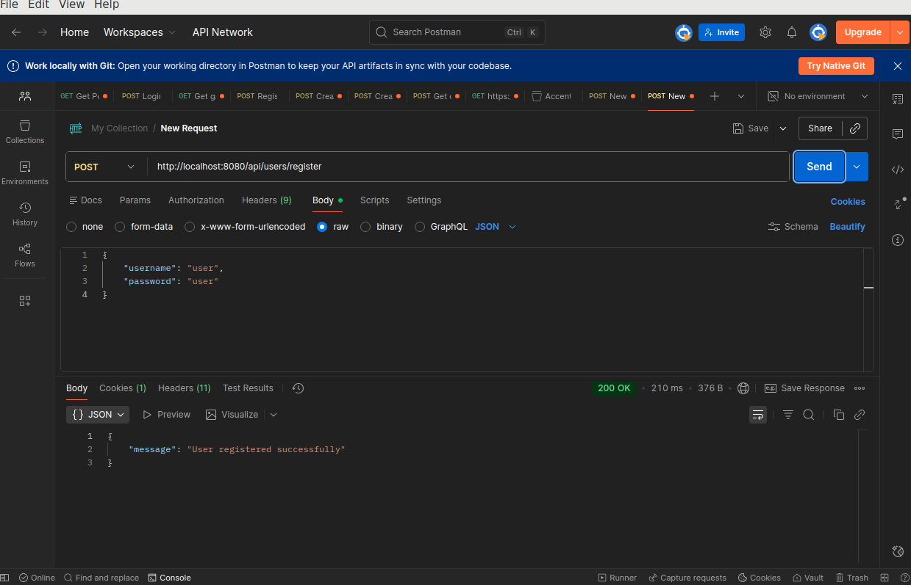
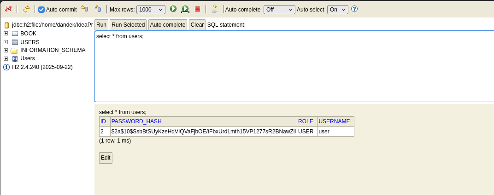
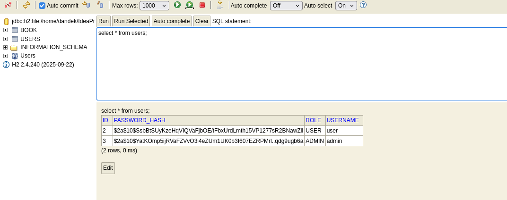
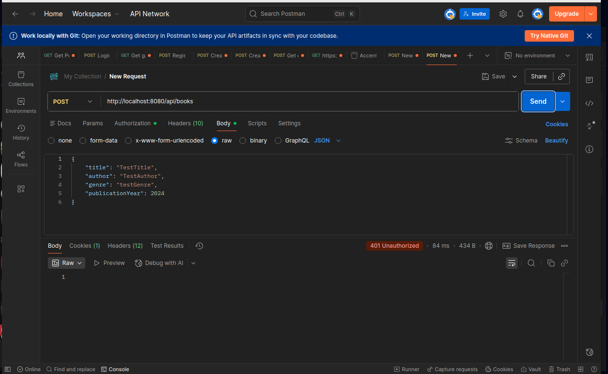
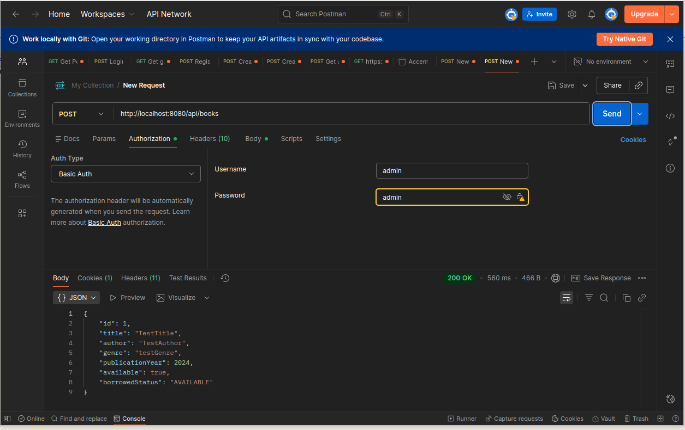
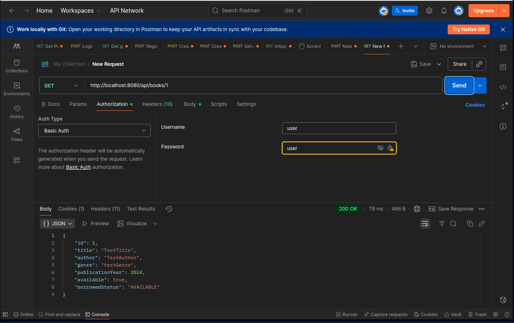
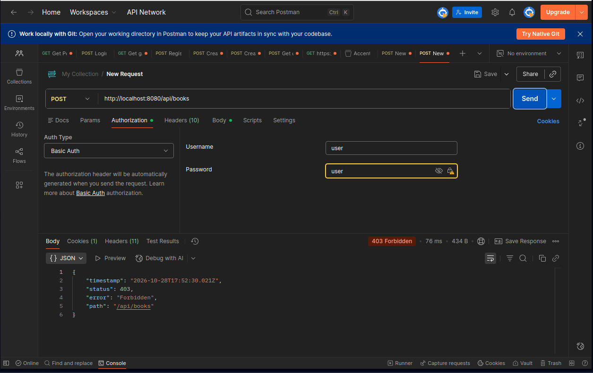

### 1. Registering a user

I added a public registration endpoint:

Registration allows the application to generate BCrypt hashes itself. There is no need to use an external password-hashing website or manually insert password hashes into the database.



### 2. Checking the stored password

During registration, the service encodes the submitted password using `BCryptPasswordEncoder` and saves the user through `AppUserRepository`.

The original password was not stored in the table.



### 3. Preparing USER and ADMIN accounts

I registered another account with the username `admin`. Registration assigns the role `USER`, so I changed this account's role manually in H2 Console for testing:

```sql
UPDATE users
SET role = 'ADMIN'
WHERE username = 'admin';
```

The database then contained two accounts: `user` with the role `USER` and `admin` with the role `ADMIN`.

`CustomUserDetailService` loads their usernames, password hashes and roles from the database for authentication.



### 4. Attempting to create a book without authentication

Without providing credentials. The application returned `401 Unauthorized`, preventing unauthenticated access to the operation.



### 5. Creating a book as ADMIN

I repeated the request using HTTP Basic authentication with the registered administrator account.

The application returned `200 OK` and the created book, including its generated ID. This confirmed that the administrator could create a book.



### 6. Reading a book as USER

I authenticated as the regular user and requested the book created in the previous step:

The application returned `200 OK` with the book data. This confirmed that a user without the `ADMIN` role could read data.



### 7. Attempting to create a book as USER

I sent another request using the regular user's Basic Auth credentials.

The application returned `403 Forbidden`. The user was authenticated but did not have the `ADMIN` role required to create a book.



